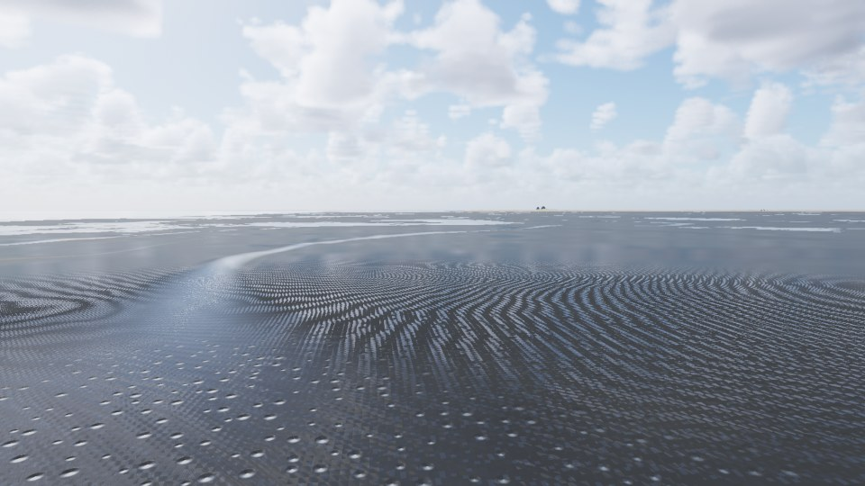
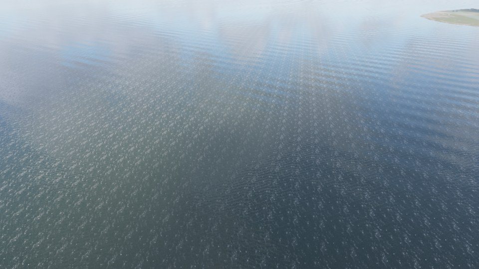
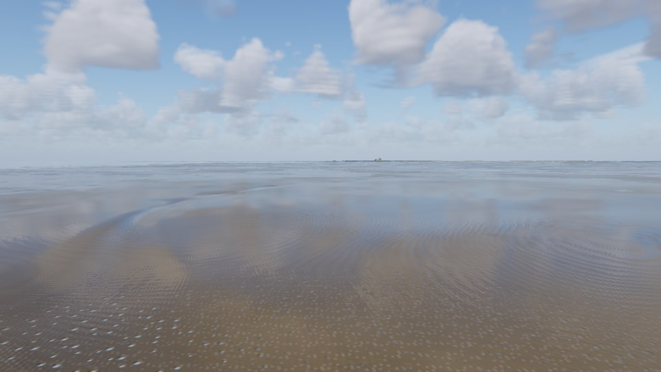
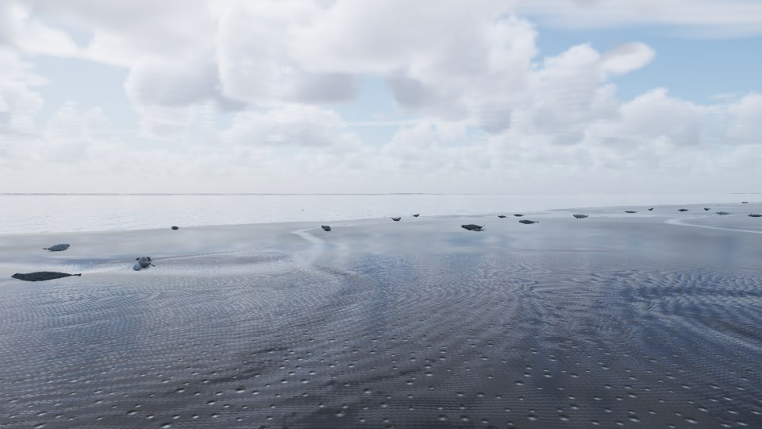
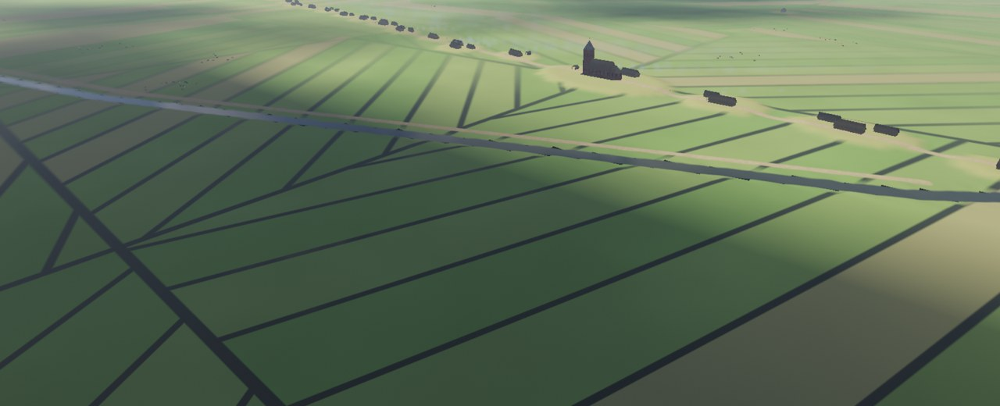
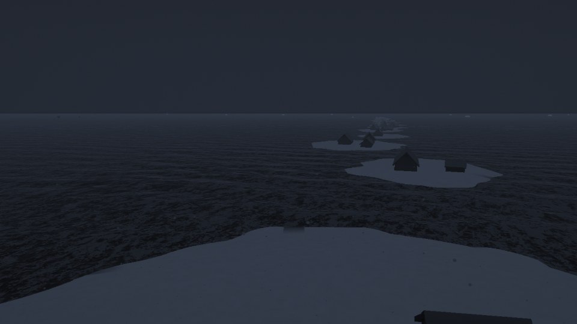
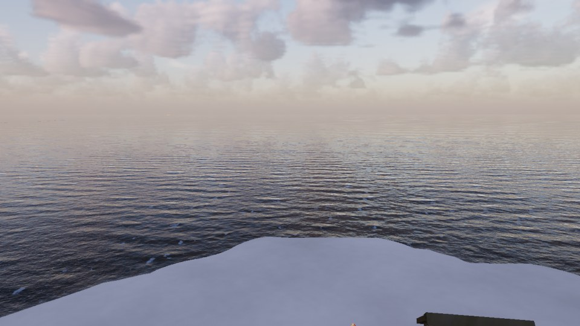
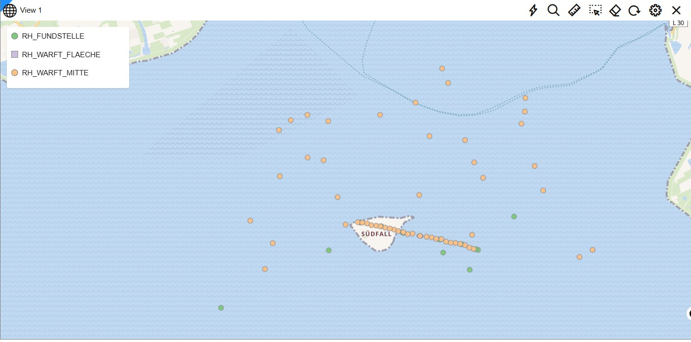

# Rungholt – Zweimal am Tag Land

Das Nordfriesische Wattenmeer zwischen Pellworm, Südfall und Nordstrand als 3D-Echtzeitszene: Alle zwölfeinhalb Stunden läuft das Wasser ab, die Priele werden zu Rinnen, die Sandbänke kommen hoch, der nasse Sand spiegelt den Himmel, die Seehunde ziehen auf die Bank, Austernfischer stochern, ein Schwarm Alpenstrandläufer wendet über dem Watt. Dann kehrt die Flut zurück. Unter diesem Watt liegt Rungholt, die Handelsstadt der Edomsharde, die in der Nacht vom 15. auf den 16. Januar 1362 unterging (so zählen die Chroniken, julianisch; die Uhr der App zählt gregorianisch, bei ihr ist es die Nacht vom 23. auf den 24., mit Springtide). Ein Schalter blendet zwischen heute und 1362.

Rungholt ist die Fortsetzung von Lighthouse, Haithabu und Glacier mit denselben Packages. Neu sind vier Packages, die jede Küstenszene brauchen kann: `tide` (Pegel und Überflutung), `mudflat` (nasser Sand als Material), `seal` (Seehunde) und `figure` (Menschen, die gehen). Jedes Package folgt demselben Vertrag: Der Kern braucht nur Java 21, `gl/` dazu JOGL, `demo/` dazu FStyle. `check-packages` übersetzt jedes Package einzeln und läuft nach jedem Übersetzen.

**Stand: Phase 17 von 17, Schliff.** Die Szene hat Gelände, Himmel und Wetter, die Tide mit Überflutung, nassen Sand, Seehunde, Wattvögel, die Wattwanderung, das Jahr, das Land und die Stadt von 1362, die Grote Mandränke mit dem Deichbruch, die Spuren im Watt, die Glocken, Klang, drei Regiebücher mit Kino und die Datenbank (Schema RUNGHOLT oder Dateien in `daten/`; Einrichten, Prüfen und QGIS in [db/README.md](db/README.md)). Dazu kommen jetzt der Dauerlauf, die Verknüpfung mit Symbol, die Quellenliste und die durchgängigen Qualitätsstufen. Plan und Fortschritt stehen im Artefakt „Rungholt Werkbuch“, die Statusbilder in `docs/status/`.

## Bilder

| | |
|---|---|
|  |  |
| Vogelauge: die Sände tauchen auf (Regiebuch „Eine Tide“) | Auf dem Watt: nasser Sand, Rippel, der Himmel im Wasserfilm |
|  |  |
| Die Kolonie bei Ebbe | Rungholt 1362: Marsch mit Gräben, die Warftenkette, die Kirche |
|  |  |
| Die Grote Mandränke: Häuser treiben in der Flut | Am Morgen danach: die Kirchwarft steht im Meer |
|  | |
| Warften und Fundstellen aus dem Schema RUNGHOLT als Karte (Abnahme Phase 16) | |

Die Bilder aus der Szene stammen von einer AMD Radeon 680M auf „Mittel“ (Blätter der Regiebücher, Phase 15).

## Die Packages

| Package | Inhalt | Stand |
|---|---|---|
| `com.dan.tide` | Pegel aus Partialtiden, Überflutung mit Laufzeit, Pfützen, Strömung | neu, Phase 4: Pegel und Überflutung; Phase 12: Becken mit eigenem Spiegel ([README](src/com/dan/tide/README.md)) |
| `com.dan.mudflat` | Watt als Material (Nässe, Trocknung, Rippel, Sediment) und Oberfläche | neu, Phase 6: Material (Nässe je Zelle, Sediment, Rippel, Wasserfilm) und Feinform (Prielkanten, Rinnsale), Phase 7: Spuren ([README](src/com/dan/mudflat/README.md)) |
| `com.dan.seal` | Seehunde als Körper und Verhalten | neu, Phase 7: Körper, Haltungen, Kolonie mit Tide, Flucht, Heulern ([README](src/com/dan/seal/README.md)) |
| `com.dan.figure` | Menschen, die gehen: Körper, Gang, Kleidung, geführte Gruppe | neu, Phase 9: die Wattwanderung nach Südfall; Phase 11: Kleidung von 1362, Phase 13: die Archäologen ([README](src/com/dan/figure/README.md)) |
| `com.dan.sky`, `cloud`, `weather`, `rain`, `fog`, `lightning` | Himmel und Wetter | aus Glacier; `weather` mit der Lage `ORKAN` (Phase 3) |
| `com.dan.ocean`, `spray`, `buoyancy`, `weathering`, `wave`, `fracture` | Wasser, Gischt, Schwimmen, Nässe, Welle, Bruch | aus Glacier; `ocean` mit Preset `watt` und `bedOutside` (Phase 2), Strömung, gebrochenem Kachelmuster, weichem Flutsaum und Unterwasser (Phase 6); `buoyancy` mit der Kogge, die trockenfällt (Phase 11); `wave` mit gehaltenem Wasserstand, `fracture` mit Klei für den Deichbruch (Phase 12) |
| `com.dan.flock`, `forest`, `ground`, `reed`, `river`, `season` | Leben und Jahr | aus Glacier; `ground` mit dem Biom `deich()` (Phase 3), `salzwiese()` und `marsch()` (Phase 10); `season` mit dem Klima Nordfriesland (Phase 9); `flock` mit den Wattvögeln `Waders` (Phase 8: Arten als Datensätze, fressen bei Ebbe, Hochwasserrastplatz, Schwarm mit Umschlag, [README](src/com/dan/flock/README.md)) |
| `com.dan.soundscape`, `store`, `kino` | Klang, Datenseite, Kinomodus | aus Glacier; `kino` für die drei Regiebücher (Phase 15); `soundscape` mit dem Watt (Phase 14: Wattvögel nach Art, Seehunde, Vieh, Glocken, Priele, Knistern, der Wind trägt den Schall, [README](src/com/dan/soundscape/README.md)) |
| `com.dan.timber`, `road`, `hearth`, `smoke`, `muster` | Fachwerk und Reet, Wege, Herd, Rauch, Paketvorlage | aus Haithabu (Stand 18.10.); `timber` mit Backstein und Friesenhaus (Phase 9), der Kirche aus Backstein (Phase 11), `moveSpecial` für die aufsteigende Kirche (Phase 13); `smoke` für den Herdrauch der Stadt (Phase 11) |
| `com.dan.rungholt` | Die App | [README](src/com/dan/rungholt/README.md) |

Abgestellt in `_alt/packages/` (F7 A): `ice`. In `_alt/db/`: `Object_nach_Schema.sql`, `TableFormat.sql`.

## Bauen und starten

- NetBeans-Projekt mit Ant, JDK 21. In `lib/`: JOGL mit Windows-Natives, `FStyle.jar`, `ojdbc11.jar`, `sdo*.jar`.
- **Clean and Build** erzeugt `dist/Rungholt.jar` mit `dist/lib`. Danach startet [Rungholt.bat](Rungholt.bat) die App ohne NetBeans, [Rungholt_Konsole.bat](Rungholt_Konsole.bat) mit Konsole.
- Voraussetzung: OpenGL 4.3 mit Compute-Shadern. Ziel: AMD Radeon 680M (2 GB), „Mittel“ hält 60 Bilder/s in Full HD.
- Verknüpfung: [Rungholt_Verknuepfung.bat](Rungholt_Verknuepfung.bat) legt „Rungholt“ mit dem Symbol `Rungholt.ico` (der halb versunkene Kirchturm im Abendlicht) auf den Desktop und ins Startmenü.
- Prüfung: Ant-Target `pruefung` endet mit „ERGEBNIS: alles in Ordnung“; `check-packages` übersetzt jedes Package einzeln.
- Dauerlauf (Abnahme „fertig“): Block TECHNIK → „Dauerlauf 30 min“ oder `-Drungholt.dauerlauf=30`. Jede Runde spielt „Eine Tide“ im Kino, zwei Tiden frei im Zeitraffer 360 und „Die Grote Mandränke“ im Kino (drei Tiden, eine Mandränke), mindestens zwei Runden. Am Ende `docs/status/Dauerlauf_….png` und `.txt` mit dem Urteil: keine Fehler, jede Runde vollständig, im Mittel 30 Bilder/s, kein Leck (Speicher am Ende jeder Runde), Grenzen der Szene, Physik nachgekommen.
- Datenbank (ab Phase 16): Schema RUNGHOLT in PDBORCL, Präfix `RH_`; `db/USER.sql` legt das Schema an.

## Daten

`templates/` (nicht im Git) hält die Vorlagen und Rohdaten: Mejer-Karte, Stimmungsbilder, Kirche, Funde, das Satellitenbild, GLO-30 und unter `templates/rasters_COP30/EasyGeo/` die Küstenhöhen der BAW (`topography_max_z_2015-2021`, 10 m, ETRS89/UTM 32, NHN), geschnitten nach `templates/rasters_BAW/rungholt_topo_10m.tif` (17,5 km, 13 MB) und mit `tools.GelaendeImport` nach `daten/gelaende` importiert (siehe [App-README](src/com/dan/rungholt/README.md)). `daten/gelaende` gehört ins Git, `templates/` nicht.

## Qualitätsstufen

Die Stufe im Block BILD gilt für alle Packages (seit Phase 17 auch für Watt, Häuser, Rauch und den Deichbruch). „Mittel“ hält 60 Bilder/s in Full HD auf der Radeon 680M, „Hoch“ mindestens 30.

| Stufe | Auflösung | Budget | Gelände am Auge | Meer | Bodendecke | Tide | Häuser bis | Wolken, Regen, Nebel, Blitz, Seehunde, Vögel, Rauch, Deichbruch |
|---|---|---|---|---|---|---|---|---|
| Niedrig | 67 % | 7,6 ms | 8 m | 3 Kaskaden, 128² | 12 m | 32 m | 2,5 km | niedrig (Wolken flach) |
| Mittel | 85 % | 15,2 ms | 2 m | 3 Kaskaden, 256² | 18 m | 16 m | 4 km | mittel (Regen niedrig) |
| Hoch | 100 % | 30,4 ms | 2 m | 4 Kaskaden, 256² | 24 m | 16 m | 6 km | hoch |
| Ultra | 100 % | 50 ms | 2 m | 4 Kaskaden, 512² | 30 m | 8 m | 9 km | ultra |

Fest bleiben der Klang (Abtastrate beim Start) und die Welle der Bresche (Gitter nach dem Ort). Wird die Grafikkarte langsamer als das Budget, sinkt die Auflösung, nie unter 50 %.

## Quellen

Alle Quellen und Befunde (belegt, gemessen, gestaltet [G]) stehen in [docs/QUELLEN.md](docs/QUELLEN.md), erzeugt von `tools.Quellenliste` aus denselben Dateien wie die Startdaten der Datenbank: 23 Quellen, 29 Befunde, die 13 belegten Sturmfluten seit 1362.

## Rückfluss

Mit Phase 17 gingen die Erweiterungen der gemeinsamen Packages zurück nach Glacier, Haithabu und Lighthouse (`weather` mit dem Orkan, `ocean` mit Strömung und weichem Flutsaum, `flock` mit den Wattvögeln, `buoyancy` mit der Kogge, `ground` mit Deich, Salzwiese und Marsch, `season` mit dem Klima Nordfrieslands, `soundscape` mit dem Watt, `wave` und `fracture` nach Glacier, `timber` nach Haithabu). Lighthouse bekam dazu `tide`: die echte Tide am Roten Sand aus dem Pegel Bremerhaven (`Tide.roterSand()`).
